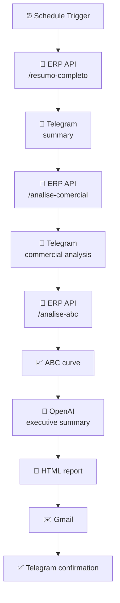

<h1 align="center">⚡ ERP Intelligence Bot ⚡</h1>

  

  
  
  
  
  

  <a href="#overview">Overview</a> •
  <a href="#impact">Impact</a> •
  <a href="#architecture">Architecture</a> •
  <a href="#how-it-works">How It Works</a> •
  <a href="#setup">Setup</a> •
  <a href="#license">License</a>

---

## Overview

An automation system that generates and distributes daily commercial reports from ERP data. It turns raw data into information that supports business decisions.

## Impact

  

| Area | Result |
|---|---|
| **Manual analysis** | Roughly 20 hours per month removed |
| **Reporting** | Daily, fully automated delivery |
| **Monitoring** | Continuous detection of losses and opportunities |
| **Management** | Standardized indicators for decision-making |

## Architecture

  

## How It Works

The workflow runs daily on a schedule and follows this sequence:

## Output (Telegram)

  
  
  

## Tech Stack

| Tool | Role |
|---|---|
| **n8n** | Workflow orchestration |
| **ERP API** | Data source |
| **OpenAI** | Executive summaries |
| **Telegram** | Real-time delivery |
| **Gmail** | Report delivery |

## Design Decision

The core logic does not depend on AI. The LLM is used only to organize and summarize the data, while the critical analysis follows business rules.

## Setup

1. Import `erp-insights-workflow.safe.json` into n8n.
2. Configure credentials for the ERP API, OpenAI, Telegram, and Gmail.
3. Point the HTTP Request nodes to your ERP API.
4. Set the schedule in the Schedule Trigger node.
5. Activate the workflow.

## Security

Sensitive data and credentials have been removed from the workflow file. You will need to configure your own credentials during setup.

## License

Released under the [MIT License](LICENSE).

## Author

**Igor Henrique** · Automation • Data • Systems
